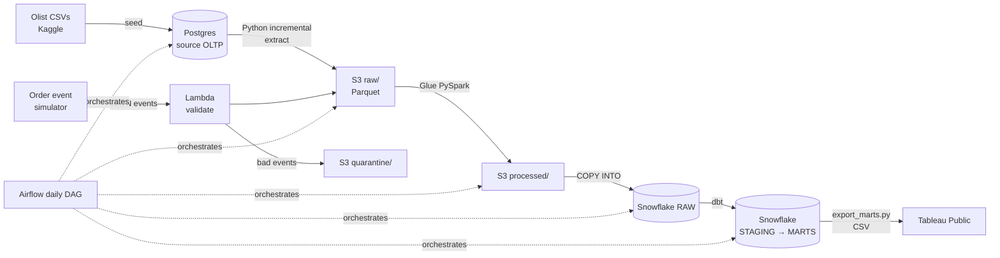

# Olist E-Commerce Analytics Pipeline

An end-to-end data engineering pipeline built on the
[Olist Brazilian E-Commerce dataset](https://www.kaggle.com/datasets/olistbr/brazilian-ecommerce)
(~100k orders, 2016–2018). It ingests orders, customers, products, payments and reviews,
lands them in an S3 data lake, transforms them with Glue and dbt, models them in Snowflake,
and publishes revenue, retention and product dashboards to Tableau Public. Airflow runs it daily.

## Architecture



### Simulating a live store
The dataset is historical, so each pipeline run processes one **business date** of Olist
history: `--date 2017-11-24` extracts that day's orders, items, payments and customers,
plus reviews created that day (they arrive *after* the order, so they're real late-arriving data).
Airflow will map its run date to an Olist date so the daily schedule replays the store.

## Roadmap

| Phase | Scope | Status |
|---|---|---|
| 1 | Postgres source DB, Python incremental extraction → data lake (local / S3), manifests, tests | ✅ done |
| 2 | AWS: S3 bucket and IAM (Terraform), run extraction against S3 | ✅ done |
| 3 | Lambda: real-time order events → validate → raw / quarantine | ⬜ |
| 4 | Glue: raw → processed (cleaning, dedupe, typing, category translation) | ⬜ |
| 5 | Snowflake: storage integration, stage, RAW tables, `COPY INTO`, reconciliation | ✅ done |
| 6 | dbt: staging → intermediate → marts, 105 tests, docs | ✅ done |
| 7 | Airflow: daily DAG, retries, SLAs, alerting | ⬜ |
| 8 | Tableau Public: Revenue, Customers & Retention, Products dashboards (marts exported to CSV) | ⬜ |
| 9 | CI (GitHub Actions: pytest + `dbt build`), data quality monitoring page | ⬜ |

## Dashboard metrics (planned)
| Metric | Definition |
|---|---|
| Total revenue | Sum of item `price` + `freight_value` for non-canceled orders |
| Monthly revenue (run rate) | Revenue per calendar month. Olist has no subscriptions, so this stands in for MRR. |
| Average order value | Revenue / distinct orders |
| Customer lifetime value | Revenue per `customer_unique_id` over their lifetime |
| Top-selling products | Units and revenue by product / English category |
| Customer churn | Share of customers with no purchase in the last N days (e.g. 180) |

> ⚠️ Use `customer_unique_id` for anything customer-level. `customer_id` is new on **every order**.

## Quick start (Phase 1)

Prerequisites: Python 3.12 (`brew install python@3.12`), [Docker Desktop](https://www.docker.com/products/docker-desktop/),
a [Kaggle API token](https://www.kaggle.com/settings) saved to `~/.kaggle/access_token`.

```bash
make setup                     # venv + dependencies + .env
make db-up                     # start Postgres in Docker
make download                  # Olist CSVs -> data/source/
make seed                      # load CSVs into Postgres (olist schema)
make extract DATE=2017-11-24   # one day -> data/lake/raw/...
make backfill START=2017-01-01 END=2017-01-31
make test
```

Set `LAKE_TARGET=s3` and `S3_BUCKET=...` in `.env` to write to AWS instead of `data/lake/`.

### Lake layout
```
raw/olist/<table>/dt=YYYY-MM-DD/<table>.parquet   # + _batch_id, _business_date, _extracted_at
raw/_manifests/dt=YYYY-MM-DD/manifest.json        # row counts per table, written last = success marker
```
Re-running a date overwrites the same files, so runs are idempotent and backfills are safe.

| Table | Load mode |
|---|---|
| orders, order_items, order_payments, customers | incremental (by order purchase date) |
| order_reviews | incremental (by review creation date) |
| products, sellers, product_category_translation | daily snapshot |
| geolocation | static (`--include-static`) |

## Phase 2: AWS data lake (Terraform)

`infra/terraform/` creates:

| Resource | Why |
|---|---|
| S3 bucket `olist-pipeline-lake-<account_id>` | Data lake (`raw/`, `processed/`, `quarantine/`) |
| Public access block, ACLs disabled, TLS-only bucket policy | Nothing in the lake is ever public or sent unencrypted |
| Versioning + SSE-S3 encryption | Recover from bad overwrites; encrypted at rest at no cost |
| Lifecycle rules | Old versions expire after 30 days, raw files over 128 KB move to Standard-IA after 90 days, quarantine expires after 90 days |
| IAM role `olist-pipeline-ingestion` | Least privilege: read/write on `raw/*` only. Assumed through STS, so there are no long-lived keys. |
| AWS Budget ($10/month) | Email alert at 80% actual or 100% forecasted spend |

```bash
# one-time: an admin IAM user's access keys in a named profile (never the root account)
aws configure --profile olist-admin

cp infra/terraform/terraform.tfvars.example infra/terraform/terraform.tfvars   # set alert_email
make tf-init && make tf-plan && make tf-apply
terraform -chdir=infra/terraform output -raw aws_config_snippet >> ~/.aws/config
```
Then in `.env` set `LAKE_TARGET=s3`, `S3_BUCKET=<lake_bucket output>` and `AWS_PROFILE=olist-ingestion`,
and run `make extract DATE=2017-11-24` and `make s3-check`.

## Phase 5: Snowflake warehouse

| Object | Details |
|---|---|
| Warehouses | `OLIST_LOAD_WH`, `OLIST_TRANSFORM_WH`, `OLIST_BI_WH`: X-Small, auto-suspend 60s, one per workload for cost attribution |
| Resource monitor | 20 credits/month: notify at 75%, suspend at 100% |
| Database `OLIST` | `RAW`, `AUDIT` (loader-owned); `STAGING`, `INTERMEDIATE`, `MARTS` (dbt-owned) |
| Roles | `OLIST_LOADER`, `OLIST_TRANSFORMER`, `OLIST_REPORTER` (read-only on MARTS) |
| Service users | `OLIST_LOADER_SVC`, `OLIST_DBT_SVC`: `TYPE = SERVICE`, key-pair auth only |
| Storage integration | `OLIST_S3_LAKE` assumes the `olist-pipeline-snowflake` IAM role (trust locked to Snowflake's IAM user + external ID). No AWS keys are stored in Snowflake. |

**Loading (ELT):** each RAW table holds `RAW_DATA VARIANT` + file metadata (`_SOURCE_FILE`, `_FILE_ROW_NUMBER`,
`_FILE_LAST_MODIFIED`, `_LOADED_AT`). Typing happens in dbt, so source schema changes never break a load.
`COPY INTO` load metadata makes re-runs no-ops.

**Reconciliation:** after each load, the rows in RAW for the manifest's `batch_id` must equal the manifest row count
for every table. Results go to `AUDIT.LOAD_RECONCILIATION`, per-file COPY results to `AUDIT.COPY_HISTORY`, and any
mismatch fails the run.

```bash
make snowflake-render     # fill snowflake/01_account_setup.sql -> build/ ; run it in Snowsight as ACCOUNTADMIN
# put DESC INTEGRATION's STORAGE_AWS_IAM_USER_ARN / STORAGE_AWS_EXTERNAL_ID in terraform.tfvars, then tf-plan / tf-apply
make sf-bootstrap         # file formats, stage, RAW + AUDIT tables
make load DATE=2017-11-24
```

> The Snowflake account is in AWS us-east-2 and the bucket in us-east-1, so S3 reads incur inter-region transfer
> (~$0.02/GB, a few cents for this whole dataset). In production you'd co-locate them.

## Phase 6: dbt transformations

```
RAW (VARIANT) ──► STAGING (views)            ──► INTERMEDIATE (views)      ──► MARTS (tables)
                  stg_olist__* x9                int_orders__items_agg         fct_orders, fct_order_items
                  type, rename, dedupe           int_orders__payments_agg      dim_customers, dim_products,
                  latest file version            int_orders__reviews_agg       dim_sellers, dim_date
                                                 int_zip_codes                 mart_revenue_monthly
                                                                               mart_customer_cohorts
                                                                               mart_product_performance
```

| Decision | Why |
|---|---|
| Customer grain = `customer_unique_id` | `customer_id` is regenerated per order; using it would make every customer look one-time |
| Revenue = merchandise + freight, excluding `canceled` / `unavailable` | Configurable via `var('non_revenue_statuses')`; tested to tie out across order, item and month grains |
| Churn = no purchase in 180 days, measured from the latest *revenue* order in the data | The "simulation clock"; trailing canceled orders don't move it. Window is `var('churn_window_days')` |
| MRR → monthly revenue run rate | Olist has no subscriptions |
| Marts are full-refresh tables, not incremental | ~100k orders rebuild in seconds; incremental logic would add risk (late-arriving reviews) for no gain at this scale |
| Geolocation cleaned to Brazil's bounding box, averaged per zip prefix | Raw data has points in other countries and many points per zip |

**Tests (105):** unique / not-null keys, relationships between every fact and dimension, accepted values
(statuses, payment types, review scores), non-negative money, cohort retention between 0 and 1, plus singular tests:
- `assert_revenue_ties_out_across_grains`: order, item and monthly revenue sums must match
- `assert_latest_loads_reconciled`: dbt won't build on top of a load whose reconciliation failed
- `assert_payments_cover_order_value`, `assert_delivered_orders_have_delivery_date`: known source quirks
  (256 and 8 rows), set to **warn**, and to fail only if they grow

**Results on the full history:**

| Metric | Value |
|---|---|
| Orders / customers | 99,441 / 96,096 |
| Total revenue | R$15,735,527.03 (matches the source database to the cent) |
| Average order value | R$160.23 |
| Repeat customers | 2,888 (3.0%) · avg CLV R$308 vs R$161 for one-time buyers |
| Month-1 retention (cohorts ≥ 100, weighted) | 0.45% |
| Churned (180-day window, as of the last revenue order 2018-09-03) | 60.4% |
| Top category | Health & Beauty, R$1.44M |

```bash
make dbt-deps && make dbt-build     # run + test everything (via scripts/dbt.sh, which loads .env)
make dbt-docs                       # lineage graph at http://localhost:8081
```

## Phase 8: Tableau Public dashboards

Tableau Public can't connect to Snowflake, so the pipeline ends with a **publish step**:
`publishing/export_marts.py` unloads each dbt mart inside Snowflake (`COPY INTO @~ … SINGLE = TRUE`, gzipped CSV),
downloads it with one `GET` (retried with backoff), decompresses it atomically into `exports/`, and checks the CSV row
count against the table. Server-side unload took the export from minutes to about a minute compared with fetching rows through the client.

```bash
make export        # exports/*.csv + exports/_manifest.json
```

Dashboards (build steps in [docs/tableau_guide.md](docs/tableau_guide.md)):
1. **Revenue Overview**: KPIs, monthly trend, new vs returning, MoM growth, revenue by state, payment mix
2. **Customers & Retention**: CLV by customer type, churn with an adjustable window (parameter), cohort heatmap
3. **Product Performance**: top categories, units vs revenue, review score vs price, top products

🔗 *Tableau Public link: (to be added)*

## Project structure
```
├── docker-compose.yml        # Postgres source DB
├── Makefile
├── ingestion/
│   ├── config.py             # env-driven settings
│   ├── tables.py             # what to extract + load mode per table
│   ├── storage.py            # local / S3 writers (same interface)
│   └── extract.py            # CLI: incremental extract -> Parquet + manifest
├── scripts/
│   ├── download_data.sh      # Kaggle download
│   └── seed_postgres.py      # CSV -> Postgres via COPY
├── sql/source/schema.sql     # source DDL
├── infra/terraform/          # S3 lake, IAM roles (ingestion + Snowflake), budget
├── snowflake/                # account setup SQL template (Phase 5)
├── loading/                  # S3 -> Snowflake COPY + reconciliation
├── dbt/                      # staging / intermediate / marts models, tests, macros
├── publishing/               # export marts -> CSV for Tableau Public
├── docs/                     # progress log, Tableau build guide
└── tests/                    # pytest: SQLite + moto (no Docker or AWS needed)
```
