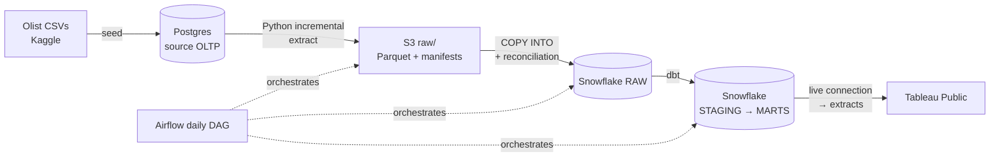
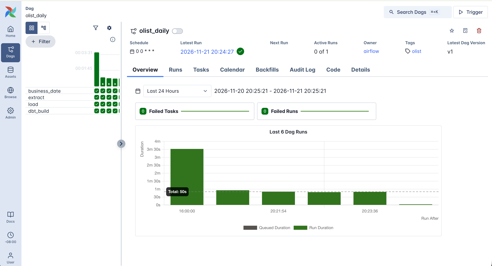

# Olist E-Commerce Analytics Pipeline

An end-to-end data engineering pipeline built on the
[Olist Brazilian E-Commerce dataset](https://www.kaggle.com/datasets/olistbr/brazilian-ecommerce)
(~100k orders, 2016–2018). It ingests orders, customers, products, payments and reviews,
lands them in an S3 data lake, loads them into Snowflake, models them with dbt,
and publishes revenue, retention and product dashboards to Tableau Public. Airflow runs it daily.

## Architecture



### Simulating a live store
The dataset is historical, so each pipeline run processes one **business date** of Olist
history: `--date 2017-11-24` extracts that day's orders, items, payments and customers,
plus reviews created that day (they arrive *after* the order, so they're real late-arriving data).
Airflow maps each run date to the Olist date nine years earlier, so the daily schedule replays the store.

## Roadmap

| Phase | Scope |
|---|---|
| 1 | Postgres source DB, Python incremental extraction → data lake (local / S3), manifests, tests |
| 2 | AWS: S3 bucket and IAM (Terraform), run extraction against S3 | 
| 3 | Snowflake: storage integration, stage, RAW tables, `COPY INTO`, reconciliation | 
| 4 | dbt: staging → intermediate → marts, 83 tests, docs |
| 5 | Airflow: daily DAG (extract → load + reconcile → dbt build), retries, timeouts | 
| 6 | Tableau: Revenue, Customers & Retention, Products dashboards ([live on Tableau Public](https://public.tableau.com/app/profile/tong.wang8791/viz/OlistE-CommerceAnalytics_17953182152810/RevenueOverview)) | 


## Dashboard metrics
| Metric | Definition |
|---|---|
| Total revenue | Sum of item `price` + `freight_value` for non-canceled orders |
| Monthly revenue (run rate) | Revenue per calendar month. Olist has no subscriptions, so this stands in for MRR. |
| Average order value | Revenue / distinct orders |
| Customer lifetime value | Revenue per `customer_unique_id` over their lifetime |
| Top-selling products | Units and revenue by product / English category |
| Customer churn | Share of customers with no purchase in the last N days (e.g. 180) |


## Quick start (Phase 1)

Prerequisites: Python 3.12 (`brew install python@3.12`), [Docker Desktop](https://www.docker.com/products/docker-desktop/),
a [Kaggle API token](https://www.kaggle.com/settings) saved to `~/.kaggle/access_token`.

```bash
make setup                     # venv + dependencies + .env
make db-up                     # start Postgres in Docker
make download                  # Olist CSVs -> data/source/
make seed                      # load CSVs into Postgres (olist schema)
make extract DATE=2017-11-24   # one day -> data/lake/raw/...
make backfill START=2017-01-01 END=2017-01-31
make test
```

### Lake layout
```
raw/olist/<table>/dt=YYYY-MM-DD/<table>.parquet   # + _batch_id, _business_date, _extracted_at
raw/_manifests/dt=YYYY-MM-DD/manifest.json        # row counts per table, written last = success marker
```

| Table | Load mode |
|---|---|
| orders, order_items, order_payments, customers | incremental (by order purchase date) |
| order_reviews | incremental (by review creation date) |
| products, sellers, product_category_translation | daily snapshot |
| geolocation | static (`--include-static`) |

## Phase 2: AWS data lake (Terraform)

`infra/terraform/` creates:

| Resource | Why |
|---|---|
| S3 bucket `olist-pipeline-lake-<account_id>` | Data lake: `raw/` (prefixes `processed/` and `quarantine/` reserved for later stages) |
| Public access block, ACLs disabled, TLS-only bucket policy | Nothing in the lake is ever public or sent unencrypted |
| Versioning + SSE-S3 encryption | Recover from bad overwrites; encrypted at rest at no cost |
| Lifecycle rules | Old versions expire after 30 days, raw files over 128 KB move to Standard-IA after 90 days, quarantine expires after 90 days |
| IAM role `olist-pipeline-ingestion` | Least privilege: read/write on `raw/*` only. Assumed through STS, so there are no long-lived keys. |
| AWS Budget ($10/month) | Email alert at 80% actual or 100% forecasted spend |


## Phase 3: Snowflake warehouse

| Object | Details |
|---|---|
| Warehouses | `OLIST_LOAD_WH`, `OLIST_TRANSFORM_WH`, `OLIST_BI_WH`: X-Small, auto-suspend 60s, one per workload for cost attribution |
| Resource monitor | 20 credits/month: notify at 75%, suspend at 100% |
| Database `OLIST` | `RAW`, `AUDIT` (loader-owned); `STAGING`, `INTERMEDIATE`, `MARTS` (dbt-owned) |
| Roles | `OLIST_LOADER`, `OLIST_TRANSFORMER`, `OLIST_REPORTER` (read-only on MARTS) |
| Service users | `OLIST_LOADER_SVC`, `OLIST_DBT_SVC`: `TYPE = SERVICE`, key-pair auth only |
| Storage integration | `OLIST_S3_LAKE` assumes the `olist-pipeline-snowflake` IAM role (trust locked to Snowflake's IAM user + external ID). No AWS keys are stored in Snowflake. |


```bash
make snowflake-render     # fill snowflake/01_account_setup.sql -> build/ ; run it in Snowsight as ACCOUNTADMIN
# put DESC INTEGRATION's STORAGE_AWS_IAM_USER_ARN / STORAGE_AWS_EXTERNAL_ID in terraform.tfvars, then tf-plan / tf-apply
make sf-bootstrap         # file formats, stage, RAW + AUDIT tables
make load DATE=2017-11-24
```

## Phase 4: dbt transformations

```
RAW (VARIANT) ──► STAGING (views)            ──► INTERMEDIATE (views)      ──► MARTS (tables)
                  stg_olist__* x9                int_orders__items_agg         fct_orders, fct_order_items
                  type, rename, dedupe           int_orders__payments_agg      dim_customers, dim_products,
                  latest file version            int_orders__reviews_agg       dim_sellers, dim_date
                                                 int_zip_codes                 mart_revenue_monthly
                                                                               mart_customer_cohorts
                                                                               mart_product_performance
```

**Results on the full history:**

| Metric | Value |
|---|---|
| Orders / customers | 99,441 / 96,096 |
| Total revenue | R$15,735,527.03 (matches the source database to the cent) |
| Average order value | R$160.23 |
| Repeat customers | 2,888 (3.0%) · avg CLV R$308 vs R$161 for one-time buyers |
| Month-1 retention (cohorts ≥ 100, weighted) | 0.45% |
| Churned (180-day window, as of the last revenue order 2018-09-03) | 60.4% |
| Top category | Health & Beauty, R$1.44M |

```bash
make dbt-deps && make dbt-build     # run + test everything (via scripts/dbt.sh, which loads .env)
make dbt-docs                       # lineage graph at http://localhost:8081
```

## Phase 5: Airflow orchestration

The DAG `olist_daily` ([airflow/dags/olist_daily.py](airflow/dags/olist_daily.py)) runs one Olist business date
end to end: `business_date → extract → load (+ reconciliation) → dbt_build`. 


```bash
make airflow-up       # UI on http://localhost:8080 (local only, no login)
make airflow-down
```



## Phase 6: Tableau dashboards

🔗 **[View the dashboards on Tableau Public](https://public.tableau.com/app/profile/tong.wang8791/viz/OlistE-CommerceAnalytics_17953182152810/RevenueOverview)**

Built in Tableau Desktop on a **live connection to the Snowflake `MARTS` schema** (OAuth through the
`TABLEAU_DESKTOP_OAUTH` security integration, read-only role `OLIST_REPORTER`, dedicated `OLIST_BI_WH` warehouse),
then switched to extracts and published to Tableau Public. Build steps and expected values:
[docs/tableau_guide.md](docs/tableau_guide.md).

| Dashboard | What it shows | Headline |
|---|---|---|
| **Revenue Overview** | KPIs, monthly trend, new vs returning buyers, MoM growth, revenue by state, payment mix | Revenue grew ~8x from Jan 2017 to 2018 (Black Friday 2017 peak: R$1.17M); ~98% of each month's buyers are new |
| **Customers & Retention** | Buyers, repeat rate, CLV, churn with an adjustable window (parameter), cohort retention heatmap, recency histogram | Only 3% of customers buy twice; month-1 retention is 0.45%; churn is 60.4% at 180 days |
| **Product Performance** | Top categories coloured by rating, volume vs value, rating vs price, top products | Health & Beauty leads revenue (R$1.44M); the top 20 products are only 5.2% of revenue (long tail) |


## Project structure

```
├── docker-compose.yml        # Postgres source DB
├── Makefile
├── ingestion/
│   ├── config.py             # env-driven settings
│   ├── tables.py             # what to extract + load mode per table
│   ├── storage.py            # local / S3 writers (same interface)
│   └── extract.py            # CLI: incremental extract -> Parquet + manifest
├── scripts/
│   ├── download_data.sh      # Kaggle download
│   └── seed_postgres.py      # CSV -> Postgres via COPY
├── sql/source/schema.sql     # source DDL
├── infra/terraform/          # S3 lake, IAM roles (ingestion + Snowflake), budget
├── snowflake/                # account setup SQL template (Phase 5)
├── loading/                  # S3 -> Snowflake COPY + reconciliation
├── dbt/                      # staging / intermediate / marts models, tests, macros
├── airflow/                  # daily DAG + Docker image
├── publishing/               # export marts -> CSV for Tableau Public
├── docs/                     # progress log, Tableau build guide
└── tests/                    # pytest: SQLite + moto (no Docker or AWS needed)
```
